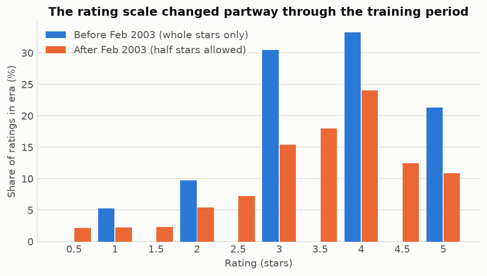
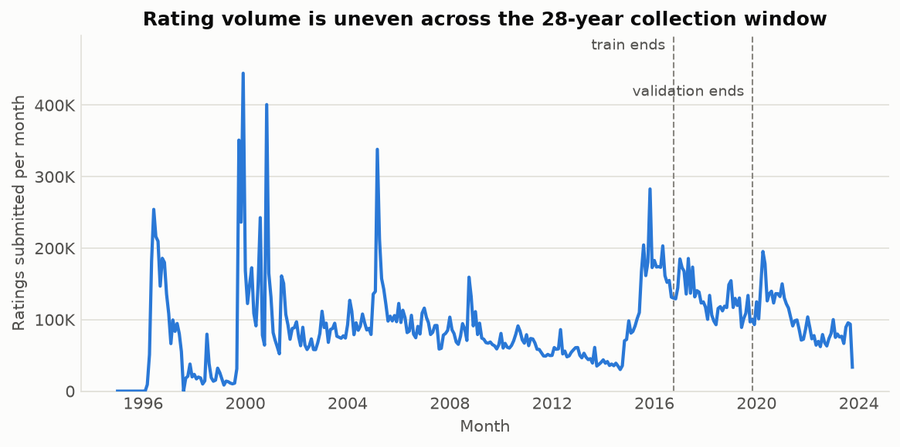
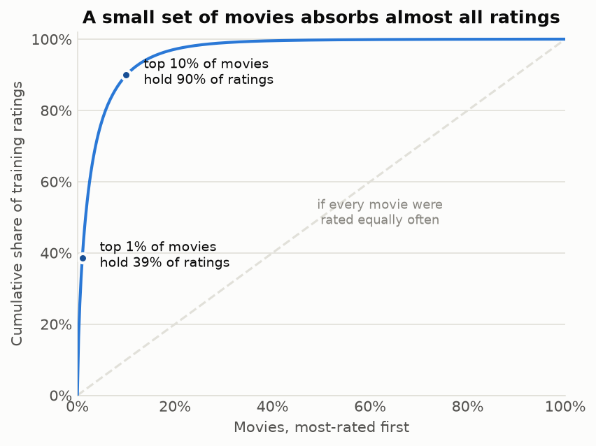
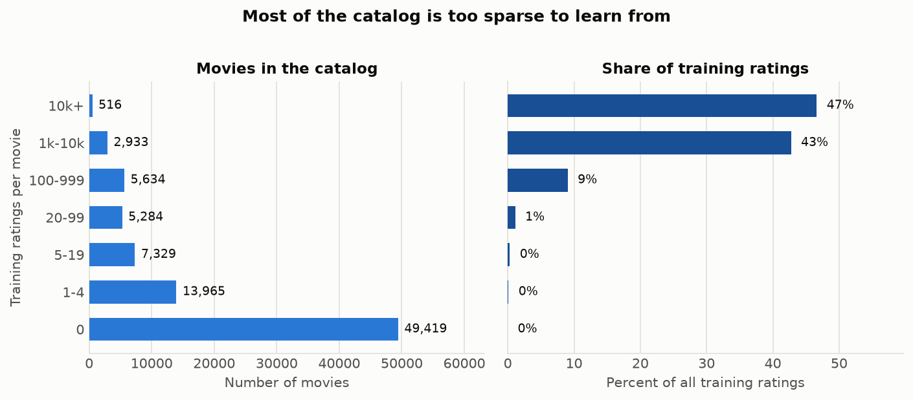
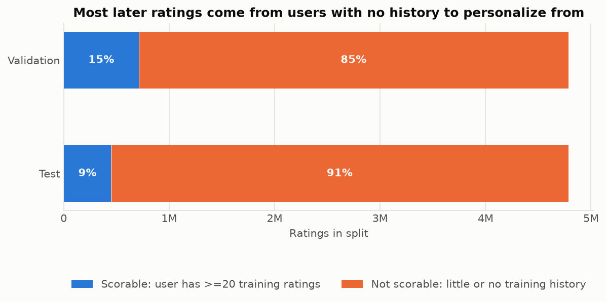

# D2 — Data Preparation and EDA

**DTSC 3602 — Deliverable 2** · Ishika Bhattarai, A.J. Jensen, Srijith G Menon,
Yashvi Patel, Yager Range, Max Valentine

**Research question (approved in D1).** Can a personalized model built from a user's
earlier ratings recommend movies they go on to rate highly, better than recommending
the most popular movies?

**Repository.** `DTSC3602FinalProject`, branch `D2`
**Dashboard.** https://ajjensen77--dtsc-3602-final-project-d2-run.us-east.modal.run

---

## 1. Sources, access, and terms

| Source | Role | Size |
|---|---|---|
| [MovieLens 32M](https://grouplens.org/datasets/movielens/32m/) | User ratings — the signal and the target | 32,000,204 ratings, 239 MB |
| [IMDb `title.basics`](https://datasets.imdbws.com/) | Title type, used to remove television | 12,903,429 titles |

Both were downloaded and inspected directly; MovieLens was checked against its
published MD5 checksums. Every number below is measured by `audit_raw.py` and
`prepare_data.py`, not copied from a README. Raw files are gitignored; the README
documents how to recreate them.

MovieLens is free for non-commercial research with attribution, may not imply
GroupLens endorsement, and needs permission for commercial use; IMDb's datasets are
free for non-commercial use. Neither contains demographics — each user is an opaque
integer — though rating histories are themselves identifying, so no per-user data is
republished.

**Deviation from D1.** D1 proposed a Kaggle TMDB–IMDb file for metadata. We used
IMDb's official `title.basics` instead: first-party, refreshed daily, and it carries
the `titleType` field that turned out to be essential (§2). The Kaggle file remains an
option in D5 if the website needs posters or plot summaries.

## 2. Preparation

**Removing television.** MovieLens is described as a movie dataset but its catalog
includes TV, and nothing marks it: `movies.csv` has only `movieId`, `title`, and
`genres`, and only 30 of 87,585 titles carry any season or episode marker in their
text. Every entry was therefore joined to IMDb through `links.csv` — which supplies an
`imdbId` for all 87,585 rows — and filtered on `titleType`.

**Dropped (2,505 titles):** `tvSpecial` 899, `tvEpisode` 762, `tvMiniSeries` 536,
`tvShort` 171, `tvSeries` 135, `videoGame` 2.
**Kept (85,080):** `movie` 71,231, `tvMovie` 6,055, `short` 5,251, `video` 2,315,
unmatched 228.

A `tvMovie` (made-for-TV film) and a `video` (direct-to-video) are standalone films,
not shows, so they stay. The 228 unmatched rows were inspected by hand — ordinary
films with a stale `imdbId` (*Wallace & Gromit*, *Clockstoppers*, *Pokémon 3*) — and
were kept and flagged rather than silently dropped.

This cost **106,959 ratings (0.33%)**. The largest losses are prestige miniseries and
stand-up specials — *Dr. Horrible's Sing-Along Blog* (5,158), *Pride and Prejudice*
(3,088), *Planet Earth* (2,948) — all popular titles, so the removal slightly weakens
the popularity baseline rather than being neutral.

**Cleaning audit.** The raw files were cleaner than expected. Each of these returned
**zero**: null values in any ratings column, duplicate `(userId, movieId)` pairs,
ratings outside 0.5–5.0, timestamps outside 1995–2023, ratings referencing an unknown
`movieId`, and duplicate `movieId` in the catalog. Deduplication logic is kept anyway,
since it is cheap and the next release may not be as clean.

**Retained: 31,893,245 ratings, 200,948 users, 81,999 rated films.**

Imperfections documented rather than patched: 7,080 films carry `(no genres listed)`;
617 titles have no parseable year; 124 rows lack a `tmdbId`. 401 titles exactly
duplicate another title — genuine distinct films sharing a name (*Aladdin*,
*Dracula*), so title must never be used as a join key.

## 3. Data dictionary

`docs/data_dictionary.md` documents **72 columns across 14 tables**, generated by
`make_data_dictionary.py` from the parquet files the pipeline actually wrote, so it
cannot drift from the real schema; an undocumented column raises a build warning. The
same table is served in the dashboard's *Data dictionary* tab.

## 4. Findings

**1. The rating scale changed partway through.** MovieLens accepted only whole stars
until 18 February 2003; afterwards half-stars are 42% of ratings. The training window
spans both regimes, so star values are not one consistent measurement — a 3.5 was
*impossible* before 2003 and routine after. The whole-star era also skews higher (33%
of its ratings are 4 stars, against 24% after). D3 will test whether restricting
training to the post-2003 era changes the comparison.



**2. Rating volume is uneven across 28 years.** Monthly volume swings by an order of
magnitude — near 30K in quiet stretches, above 400K in 2000 and 2005 — driven by
MovieLens recruitment drives, not by anything about the movies. This is why the splits
in §5 are cut at **quantiles of rating count**, not at round calendar dates: equal
date ranges would hold wildly unequal evidence.



**3. A few movies absorb almost all ratings.** The top 1% of films hold 39% of
training ratings; the top 10% hold 90%. This is D1's popularity bias, measured. Two
consequences: the popularity baseline is a genuinely strong opponent rather than a
straw man, and a personalized model that merely re-ranks blockbusters can post good
accuracy while adding no value. D3 will report catalog coverage and tail performance
alongside accuracy so that outcome is visible rather than hidden.



**4. Most of the catalog is too sparse to learn from.** 49,419 of 85,080 films have
**zero** training ratings, while 516 films — 0.6% of the catalog — carry 47% of them.
The browsable catalog and the *recommendable* catalog are not the same set, and the
D5 website must not imply otherwise. Any model scoring a film with fewer than roughly
20 ratings is extrapolating.



**5. Most later ratings cannot be personalized at all.** This was not anticipated in
D1. MovieLens users join over time, so most users appearing after the training cutoff
are **new**: 84% of validation and 90% of test ratings come from users with no
training history. No model built on a user's past can score them, so a naive
"accuracy on the validation split" would be dominated by rows the personalized model
structurally cannot answer — making it look far worse than the baseline for reasons
unrelated to model quality.



D3 therefore evaluates on an explicit **scorable cohort** — users with ≥20 training
ratings and ≥5 ratings in the evaluation split:

| Split | Scorable users | Scorable ratings | Share | Mean stars (scorable) | Mean stars (excluded) |
|---|---|---|---|---|---|
| Validation | 5,906 | 712,516 | 14.9% | 3.35 | 3.60 |
| Test | 3,302 | 449,755 | 9.4% | 3.32 | 3.59 |

**The cohort is not representative.** Scorable users rate about 0.25 stars lower than
the users they exclude — heavy raters are harsher raters. Results describe experienced
MovieLens users, not newcomers, and the final report must say so rather than
generalising to "viewers". Cold-start users are a real product problem, but a
*different* one than the approved question, and popularity is the honest answer for
them.

## 5. Split design and reserved test data

The question is about predicting **later** ratings from **earlier** ones, so the data
is cut by time at the 70/15/15 quantiles of the rating timestamp. A random split would
let a model learn from a user's future to predict their past.

| Split | Ratings | Users | Films | Window | Mean stars | % unseen users |
|---|---|---|---|---|---|---|
| Train | 22,325,271 | 154,370 | 35,661 | 1995-01-09 → 2016-10-01 | 3.528 | — |
| Validation | 4,783,987 | 31,199 | 53,314 | 2016-10-01 → 2019-11-02 | 3.564 | 84.3% |
| Test *(reserved)* | 4,783,987 | 30,272 | 68,431 | 2019-11-02 → 2023-10-13 | 3.568 | 90.1% |

**Final test data is reserved.** Everything after 2019-11-02 is written to
`data/reserved_test/` beside a `SEALED.md` notice and is not read until D6, after all
settings are frozen. D3–D5 use the validation split only; any earlier read will be
disclosed. Preprocessing statistics — popularity, mean ratings, user histories — are
computed on **training rows only** and reused unchanged, so nothing crosses the
boundary. The dashboard's catalog figures are training-only for the same reason.

## 6. Risks carried into D3

1. **Popularity bias** (F3) — report coverage and tail accuracy, not accuracy alone.
2. **Cohort bias** (F5) — results apply to experienced users; never generalise.
3. **Scale drift** (F1) — test a post-2003 training window before trusting a model fit
   across both regimes.
4. **Metric mismatch** — the decision is *which ten films to show*, so a ranking metric
   (precision@10 / recall@10 at D1's 3.5-star threshold) must carry the conclusion;
   RMSE is a secondary diagnostic only.
5. **Correlation is not causation** — these are observational logs of a system that was
   already recommending. We can measure prediction, not the effect of recommending.

## 7. Reproducing

```bash
uv sync
# place ml-32m.zip and title.basics.tsv.gz under data/raw/ (see README)
uv run python audit_raw.py             # -> docs/audit_report.json
uv run python prepare_data.py          # -> data/processed/, data/reserved_test/
uv run python make_figures.py          # -> figures/
uv run python make_data_dictionary.py  # -> docs/data_dictionary.md
uv run python upload_to_supabase.py    # -> Supabase (d2_* tables)
uv run modal deploy modal_app.py       # -> live dashboard
uv run modal run verify_deployment.py  # -> confirms Supabase reachable from Modal
```

## References

Harper, F. M., & Konstan, J. A. (2015). The MovieLens Datasets: History and Context.
*ACM Transactions on Interactive Intelligent Systems*, 5(4), 19:1–19:19.
https://doi.org/10.1145/2827872

GroupLens Research. *MovieLens 32M Dataset*. https://grouplens.org/datasets/movielens/32m/

IMDb. *Non-Commercial Datasets*. https://developer.imdb.com/non-commercial-datasets/
